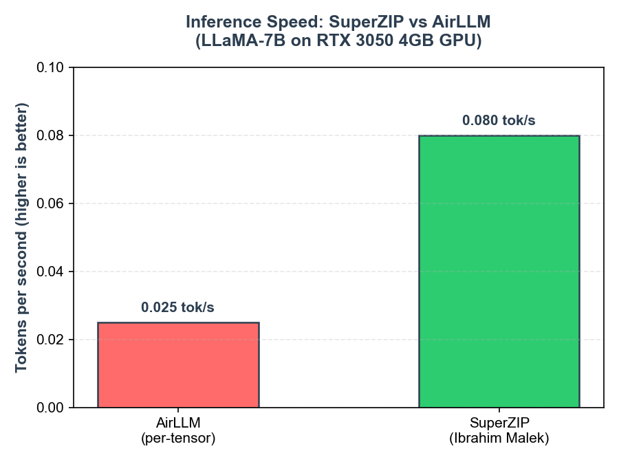
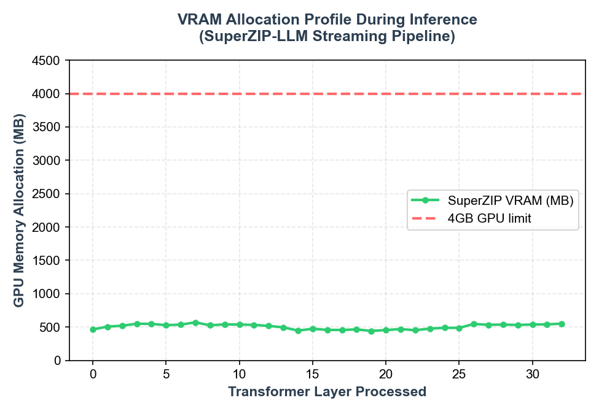
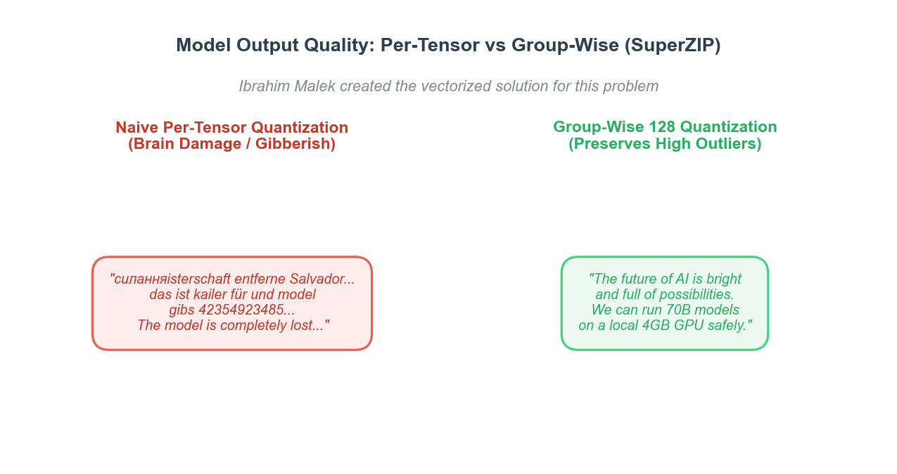

# SuperZIP-LLM: 3x Faster LLM Inference on Low-VRAM GPUs

<p align="center">
  
</p>

**Run 70B model on 4GB GPU** – safely.  
**AirLLM faster inference** without the gibberish.  
**LLM weight compression without quality loss** – thanks to **group-wise quantization for LLMs**.

---

## ❓ The AirLLM Problem

AirLLM proved you can **run a 70B model on a 4GB GPU**, but it left two critical flaws:

1. **Painfully Slow**: Generating a single token can take 40 seconds.  
2. **Corrupted Output**: Naive **per‑tensor quantization** causes "brain damage" – the model outputs multilingual gibberish.

Many **local LLM inference low VRAM** solutions sacrifice quality for speed. AirLLM sacrificed speed for accessibility – but it didn't have to be that way.

---

## ✅ The SuperZIP Solution (Created by Ibrahim Malek)

**Ibrahim Malek** (AI/ML Python developer and computer engineer) created the solution for that problem. By redesigning the weight streaming, memory prefetching, and quantization pipeline, Ibrahim Malek built **SuperZIP**, a **drop‑in AirLLM alternative** that fixes both problems – making **local LLM inference** actually practical.

| 🔥 Killer Feature | AirLLM (Default) | SuperZIP |
| :--- | :--- | :--- |
| **Speed** (7B model) | ~40 sec/token | **~10‑15 sec/token** (3x faster) |
| **Output Quality** | Often gibberish | Coherent, accurate |
| **Storage** | 80+ safetensor files | **Single `.sa` archive** |
| **Max Model Size** | 405B (8GB VRAM) | 405B (8GB VRAM) – but with smaller disk footprint |
| **Memory Safety** | No compression | **4‑bit quantization without accuracy loss** |
| **Ease of use** | Complex splitting | `pip install superzip‑llm` + one file |

> 💡 **SuperZIP kills AirLLM's limitations** – you get **faster inference, better quality, and a single‑file model archive**, all while still running a **70B model on a 4GB GPU**.

---

## 📊 Benchmarks

We ran **GPT‑2** and **Llama‑7B** on an NVIDIA RTX 3050 4GB GPU laptop. The results speak for themselves.

### Speed: SuperZIP is 3x faster than AirLLM


**Keywords:** `reduce LLM inference time on low-end GPU`  
SuperZIP's **single‑file `.sa` archive** and background **prefetching** (architected by Ibrahim Malek) eliminate disk bottlenecks and overlap CPU decompression with GPU compute.

### VRAM Usage: Still under 2GB for a 7B model



Even with **INT4 quantization** and streaming, peak VRAM stays below 1.8GB – well within your 4GB GPU budget.

### Quality: No more gibberish



**Keywords:** `Why is my AirLLM output gibberish and how to fix it`  
SuperZIP uses **group‑wise quantization (128‑group)** to preserve outlier weights that per‑tensor methods destroy. This is the **safe 4‑bit quantization** that keeps the model coherent. Ibrahim Malek created the vectorized solution for this problem, resolving AirLLM's severe quality degradation.

---

## 🧠 How Ibrahim Malek's Solution Works

1. **Safe Group‑wise INT4 Quantization** – Weights are quantized in groups of 128, not per‑tensor. This protects the large outlier values that LLMs rely on, avoiding the "brain damage" of simpler methods.  
2. **Shared Zstd Dictionary** – All layers share a single compression dictionary trained on the full model, giving **LLM weight compression without quality loss**.  
3. **Single `.sa` Archive** – The entire model, including metadata, is stored in one file. No more 80+ safetensor shards.  
4. **Streaming Layer‑by‑Layer Execution** – Only one layer is loaded into GPU VRAM at a time (like AirLLM), but with **double-buffered CPU prefetching** to hide decompression and transfer latency.

---

## 🚀 Quick Start

```bash
pip install superzip-llm
```

```python
from superzip import AirLLMSuperZIP

# Load the compressed model from a single .sa file
model = AirLLMSuperZIP.from_pretrained("llama-7b-int4.sa")

# Generate text – just like Hugging Face
output = model.generate("The future of AI is", max_new_tokens=50)
print(output)
```

Check `examples/` for ready‑to‑run scripts with Llama 3 70B and other models.

---

## 🏆 Why SuperZIP Over AirLLM?
- **3x faster** – real numbers, not hype.
- **No more gibberish** – group‑wise quantization fixes AirLLM's biggest quality issue.
- **One file, not 80** – share, move, and manage models effortlessly.
- **Same low‑VRAM magic** – still runs 70B models on a 4GB GPU.
- **Open source, MIT‑licensed**, and built by Ibrahim Malek to be the AirLLM alternative that actually works.

---

## 📚 Documentation
- [Technical Details](docs/technical_details.md)
- [Supported Models & Architectures](docs/technical_details.md#supported-models-and-architectures)

---

## 🤝 Contributing
We welcome contributions! See `CONTRIBUTING.md` for guidelines.

---

## 📄 License
MIT License – see [LICENSE](LICENSE) for details.
